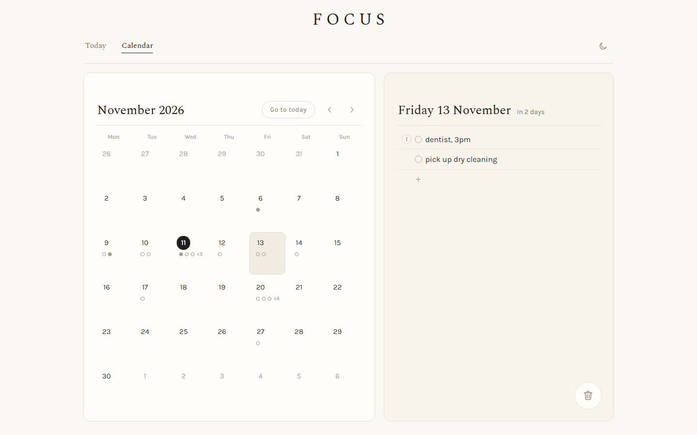

# FOCUS

[](https://github.com/rosshunterdev/today/actions/workflows/ci.yml)

A task list built around today, with a calendar for the days ahead. It's an installable web app (PWA) for phone and laptop that works fully offline, with optional sync between devices. I built it because every task app I tried felt worse than paper, and planning one day at a time is the part that paper gets right.

**Live demo:** [today-seven-kappa.vercel.app](https://today-seven-kappa.vercel.app). Everything works without an account; your lines stay in your browser.

<p>
  
  &nbsp;
  
</p>
<p>
  
</p>
<p>
  
</p>

## Status

Personal project, started in October 2026 as Today, a dot-grid journal. In November 2026 it took the name and look of FOCUS, a task manager I designed earlier as a study project. The repo, the device store and the hosted project keep the first name.

- **Works:** everything in the feature list below, offline and installed, on desktop and phone browsers.
- **Sync accounts are closed to new sign-ups.** Sync is limited to my own account, so the demo is offline-only for everyone else.
- **Not built:** password reset (there's no email), reminders, a time of day on a task, a native app.
- **Tested in CI on Chromium only** (desktop and a Pixel 7 profile). Safari and Firefox aren't covered by automated tests.

## Features

- **Two panels:** today's list under the date as a big numeral, with the week and old pages beside it. Phones show one panel at a time.
- **Write line by line:** Enter for a new line, Tab / Shift+Tab for one level of sub-steps, Backspace on an empty line to delete it.
- **Cross off with a stroke:** drag or swipe across a line to cross it off, or click its ring. Do it again to undo.
- **Headings:** start a line with `# ` or end it with `:` to make it a heading.
- **Marks:** tap the margin to highlight a line, or mark it ! or ?.
- **Reorder:** drag the grip on desktop, or long-press and drag on a phone.
- **Bin:** drag a line into the bin, with five seconds to undo (Ctrl+Z works too).
- **Old pages:** unfinished tasks from earlier days stay listed under the week until you move or bin them.
- **Tomorrow:** a folded section at the bottom of today's page for writing tomorrow's list the evening before.
- **Notes:** a pencil at the end of a line unfolds a note under it.
- **This week:** a short list of goals for the week in the second panel.
- **Calendar:** a month where each day shows one ring per line, open or done. Write on any coming day and the line is on today's page when that day arrives. Past days are read only.
- **Night pages:** dark colours, remembered per device.
- **4am day boundary:** 02:30 on Friday still counts as Thursday.
- **Optional sync:** sign in with a username and password and the same pages show up on every device.

## How it works

```
 Browser (installed PWA)                                   Supabase (optional)
┌──────────────────────────────────────────┐            ┌─────────────────────────┐
│ Service worker: app shell and fonts      │            │ Auth (username accounts)│
│ cached, so it opens with no connection   │            │ Postgres: tasks, goals, │
│                                          │            │ days, weeks             │
│ React UI                                 │            │ Row-level security:     │
│   │ reads and writes only through        │            │ user_id = auth.uid()    │
│   ▼                                      │            └─────────────────────────┘
│ store (Dexie on IndexedDB)  ◄── sync ────┼──── HTTPS ───────────▲
│                                          │   CSP: connect-src 'self'
└──────────────────────────────────────────┘        https://*.supabase.co
 Static files on Vercel
```

- **Offline first.** Every read and write goes to IndexedDB through Dexie in `src/store/`. The UI never talks to the network, so the app behaves the same with or without a connection.
- **Sync is optional.** A build without Supabase keys has no sync at all: no cloud button and no network calls. With keys, `src/sync/` pulls rows changed on the server since the last pull, then pushes rows changed on the device. Sync runs when the app opens or regains focus, 2 seconds after the last edit, and when the connection comes back. Failures retry with a growing wait.
- **Conflicts.** Every write sets `updatedAt`, and deletes are soft. For each row the newer `updatedAt` wins, and the server drops a write older than the row it holds.
- **Row-level security.** Each table's policies limit every row to its owner (`user_id = auth.uid()`). Rows can't be hard deleted, and deleting an account removes its rows. The policies have their own tests (see Testing).
- **Line order** uses fractional indexing: each line has a sortable string position, so moving a line never renumbers the others.
- **PWA.** vite-plugin-pwa generates a Workbox service worker that caches the app and its fonts, and updates itself when a new version is deployed.
- **Content Security Policy** (`vercel.json`): scripts, styles, fonts and images only from the app itself, network connections only to the app and Supabase, and no framing.

## Tech stack

| Area | Tools |
|---|---|
| App | React 19, TypeScript 7, Vite 8 |
| Storage | Dexie 4 (IndexedDB) |
| Sync and accounts | Supabase JS 2 (Postgres, Auth, row-level security) |
| Drag and drop | dnd-kit 6 |
| Offline and install | vite-plugin-pwa 1 (Workbox) |
| Tests | Vitest 5, Testing Library, fake-indexeddb, Playwright 1.63 |
| CI and hosting | GitHub Actions, Vercel |

## Running it locally

Needs Node 24.

```bash
npm ci
npm run dev       # dev server (no sync unless .env.development.local has Supabase keys)
npm run build     # type-check and production build
npm run preview   # serve the production build
```

To try sync locally, start a local Supabase (needs Docker and the [Supabase CLI](https://supabase.com/docs/guides/cli)), which also applies the migrations in `supabase/migrations`:

```bash
supabase start
supabase status   # shows the local API URL and keys
```

Then copy `.env.example` to `.env.development.local` and fill in the local values:

```bash
VITE_SUPABASE_URL=http://127.0.0.1:54321
VITE_SUPABASE_PUBLISHABLE_KEY=<publishable or anon key from supabase status>
```

## Testing

```bash
npm test          # unit and component tests (Vitest)
npm run e2e       # end-to-end tests (Playwright; builds and serves on port 4173)
npm run test:rls  # row-level security and sign-in tests (needs supabase start and .env.test.local)
```

| Suite | Tests | What it covers |
|---|---|---|
| Unit and component (Vitest) | 331 in 40 files | day rules, the calendar's month maths, ordering, the store, the sync engine and loop, and the UI with Testing Library on fake-indexeddb |
| Row-level security (Vitest) | 31 in 3 files | each table's policies against a real local Supabase: owners only, no hard deletes, signed-out visitors get nothing, account deletion |
| End-to-end (Playwright) | 25 in 9 files, 34 runs across desktop Chrome and a Pixel 7 profile (some tests apply to one profile only) | writing, crossing off, reordering, the bin, notes, headings, the week, old pages, tomorrow, the calendar, night pages, and data surviving a reload |

Unit tests run in the `Pacific/Auckland` time zone so the 4am rollover behaves the same on every machine.

CI runs all three suites plus the type-check and build on every pull request and push to `main`. The row-level security job starts a throwaway Supabase in Docker from the migrations, so it needs no secrets and never touches a hosted project.

## How I built it

Built with Claude Code. I set the specs and acceptance criteria, reviewed every change, and tested it on my own phone and laptop.

## Licence

[MIT](LICENSE)
