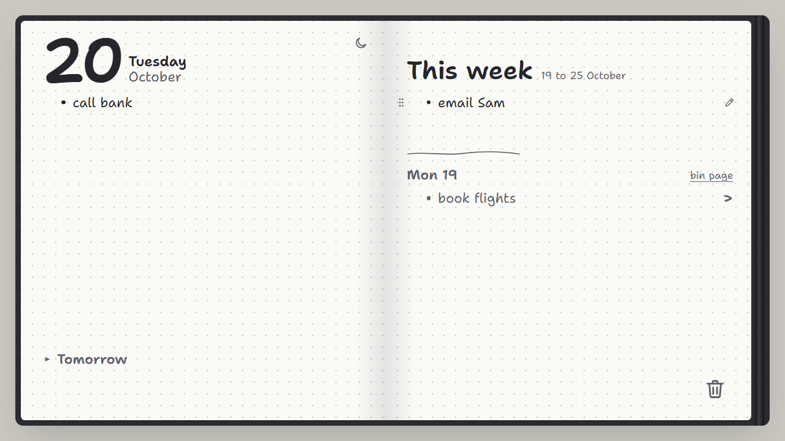
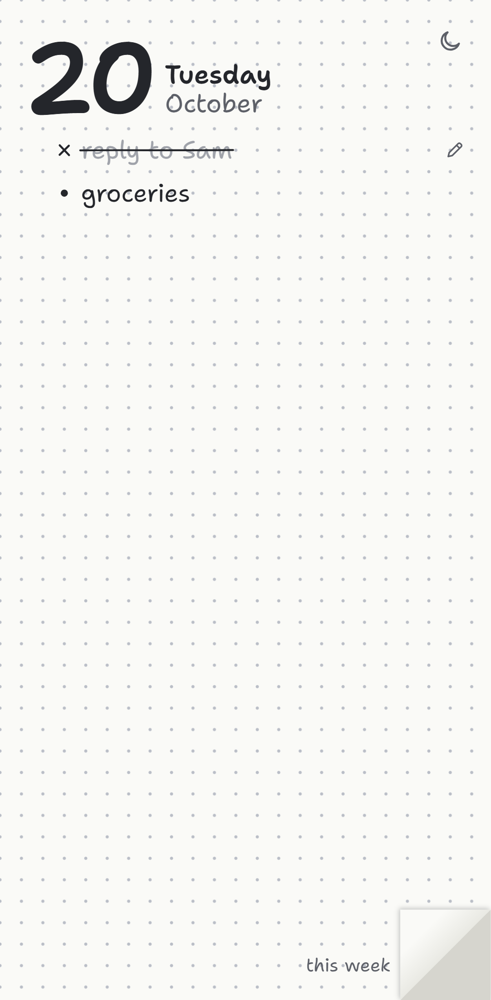

# Today

[](https://github.com/rosshunterdev/today/actions/workflows/ci.yml)

A today-only task list that feels like the pen-and-paper list you write each morning. It's an installable, offline-first web app (PWA) for phone and laptop.

<p>
  
  &nbsp;
  
</p>

## Why

Task apps tend to feel worse than paper. Paper is always ready, crossing things off feels good, and writing the list is how the day gets planned. This app keeps those parts and drops everything else. It holds **today, plus a short note of this week's goals**: no backlog, projects, tags, due dates, priorities or streaks.

## Features

- **Notebook page:** lined paper, a margin line, a handwritten-style font, and the date at the top.
- **Write line by line:** Enter for a new line, Tab / Shift+Tab for one level of sub-steps, Backspace on an empty line to delete it.
- **Cross off with a stroke:** drag the mouse or swipe a finger across a line to draw a red pen stroke through it. Do it again to undo.
- **Margin marks:** click or tap the margin to cycle ★, ! and ?.
- **Reorder:** drag the ⠿ handle on desktop, or long-press and drag on a phone.
- **Old pages:** unfinished tasks from earlier days stay pinned beside today as small torn-off pages. Drag a line onto today or into the week when you're ready for it, and bin the page once it's done.
- **This week:** a sticky note of goals for the week. Drag a task onto it, drag a goal back to today, and bring last week's unfinished goals forward.
- **4am day boundary:** 02:30 Friday still counts as Thursday.
- **Phone keyboard bar:** ⇥ / ⇤ buttons above the keyboard for sub-steps.
- **Installable and offline:** works with no connection; data is stored on the device.

## Stack

| Area | Tools |
|---|---|
| App | React, TypeScript, Vite |
| Storage | Dexie (IndexedDB) |
| Drag and drop | dnd-kit |
| Offline / install | vite-plugin-pwa (Workbox service worker) |
| Tests | Vitest, Testing Library, fake-indexeddb, Playwright |
| CI | GitHub Actions |

## How it's built

- **The UI only talks to the store.** Components read and write through `src/store/*` and never touch the database directly, which leaves room for a sync layer later without changing the UI.
- **Pure logic is separate from React.** Day rollover, old page rules (`src/day/`) and line ordering (`src/order/`) are plain functions with their own unit tests.
- **Fractional indexing for order.** Each line has a sortable string position, so moving a line between two others never renumbers the rest.
- **Every write sets `updatedAt`, and deletes are soft.** This keeps the data ready for last-write-wins sync.

## Getting started

Built and tested on Node 24.

```bash
npm ci
npm run dev       # dev server
npm run build     # type-check and production build
npm run preview   # serve the production build
```

## Testing

```bash
npm test          # unit and component tests (Vitest)
npm run e2e       # end-to-end tests (Playwright; builds and serves on port 4173)
```

Unit tests run in the `Pacific/Auckland` time zone so the 4am rollover behaves the same on every machine. The end-to-end test writes two tasks, crosses one off, reloads, and checks that everything was saved, on both a desktop and a phone (Pixel 7) profile.

CI runs both suites, plus the type-check and build, on every pull request and push to `main`.

## Roadmap

- Sign in with an emailed code and sync between devices (Supabase, with row-level security).
- Deploy to Vercel.

## License

[MIT](LICENSE)
