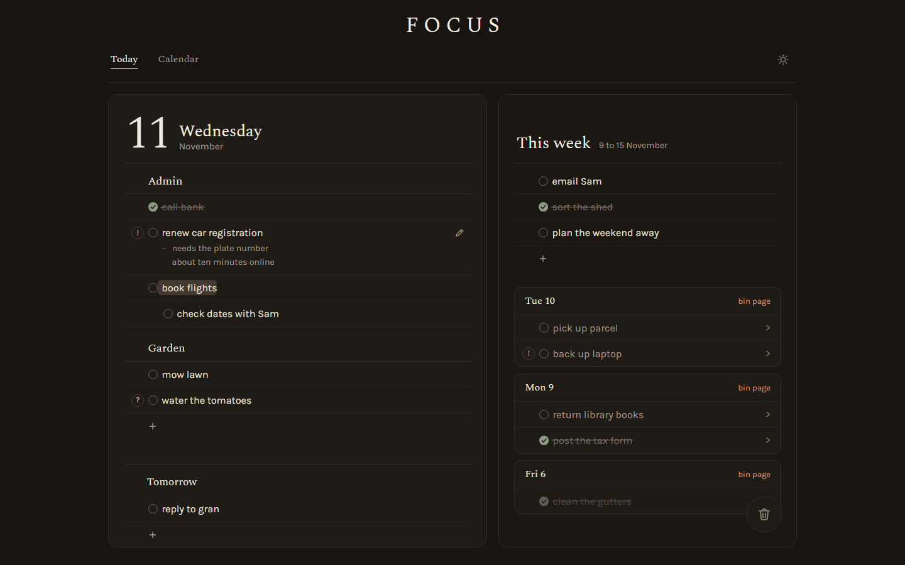

# Today

[](https://github.com/rosshunterdev/today/actions/workflows/ci.yml)

A today-only task list that feels like the pen-and-paper list you write each morning. It's an installable, offline-first web app (PWA) for phone and laptop.

**Try it:** [today-seven-kappa.vercel.app](https://today-seven-kappa.vercel.app)

<p>
  
  &nbsp;
  
</p>
<p>
  
</p>

## Why

Task apps tend to feel worse than paper. Paper is always ready, crossing things off feels good, and writing the list is how the day gets planned. This app keeps those parts and drops everything else. It holds **today, plus a short note of this week's goals**: no backlog, projects, tags, due dates, priorities or streaks.

## Features

- **Dot-grid journal:** dot-grid paper, a handwritten-style font and the date as a big numeral. On a wide screen the journal lies open and fills the screen: today on the left, the week and old pages on the right.
- **Write line by line:** Enter for a new line, Tab / Shift+Tab for one level of sub-steps, Backspace on an empty line to delete it.
- **Cross off with a stroke:** drag the mouse or swipe a finger across a line to turn its bullet into a cross and draw a pen stroke through it. Do it again to undo.
- **Marks:** click or tap the margin to highlight a line, or mark it ! or ?.
- **Reorder:** drag the dotted grip on desktop, or long-press and drag on a phone.
- **Bin:** drag a line into the bin to throw it away, with five seconds to undo it (Ctrl+Z works too).
- **Old pages:** unfinished tasks from earlier days stay listed under the week. Tap > to send a line to today, or drag it onto today or into the week, and bin the page once it's done.
- **Tomorrow:** a folded heading on the bottom edge of today's page for writing tomorrow's list the evening before. Tap it to start writing, or drag lines into it from today, the week and old pages. At 4am its lines are today's.
- **Notes:** tap the pencil at the end of a line to unfold a note under it, for the details behind a short task.
- **This week:** goals for the week on the facing page (a folded corner away on a phone). Drag a task onto it, drag a goal back to today, and bring last week's unfinished goals forward.
- **Night pages:** a moon in the header turns the journal dark, and it stays that way on that device.
- **4am day boundary:** 02:30 Friday still counts as Thursday.
- **Phone keyboard bar:** ⇥ / ⇤ buttons above the keyboard for sub-steps.
- **Installable and offline:** works with no connection; data is stored on the device.
- **Optional sync:** the cloud beside the moon signs in with a username and password, and the same pages show up on every device. Without an account, everything stays on the device.

## Stack

| Area | Tools |
|---|---|
| App | React, TypeScript, Vite |
| Storage | Dexie (IndexedDB) |
| Sync and accounts | Supabase (Postgres, Auth, row-level security) |
| Drag and drop | dnd-kit |
| Offline / install | vite-plugin-pwa (Workbox service worker) |
| Tests | Vitest, Testing Library, fake-indexeddb, Playwright |
| CI | GitHub Actions |

## How it's built

- **The UI only talks to the store.** Components read and write through `src/store/*` and never touch the database directly, which leaves room for a sync layer later without changing the UI.
- **Sync is optional and sits beside the store.** Signed-in devices sync through Supabase (Postgres with row-level security); a build without keys has no sync code paths at all. The UI reads sync state through one hook, `useSync()`.
- **Pure logic is separate from React.** Day rollover, old page rules (`src/day/`) and line ordering (`src/order/`) are plain functions with their own unit tests.
- **Fractional indexing for order.** Each line has a sortable string position, so moving a line between two others never renumbers the rest.
- **Every write sets `updatedAt`, and deletes are soft.** This keeps the data ready for last-write-wins sync.

## Getting started

Built and tested on Node 24.

```bash
npm ci
npm run dev       # dev server
npm run build     # type-check and production build
npm run preview   # serve the production build
```

## Testing

```bash
npm test          # unit and component tests (Vitest)
npm run e2e       # end-to-end tests (Playwright; builds and serves on port 4173)
npm run test:rls  # row-level security and sign-in tests against a Supabase project (needs .env.test.local)
```

Unit tests run in the `Pacific/Auckland` time zone so the 4am rollover behaves the same on every machine. The end-to-end test writes two tasks, crosses one off, reloads, and checks that everything was saved, on both a desktop and a phone (Pixel 7) profile.

CI runs both suites, plus the type-check and build, on every pull request and push to `main`.

## License

[MIT](LICENSE)
